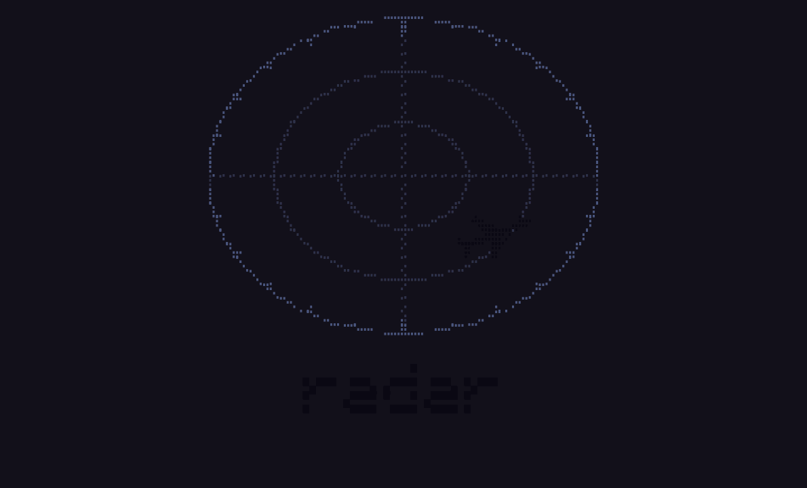
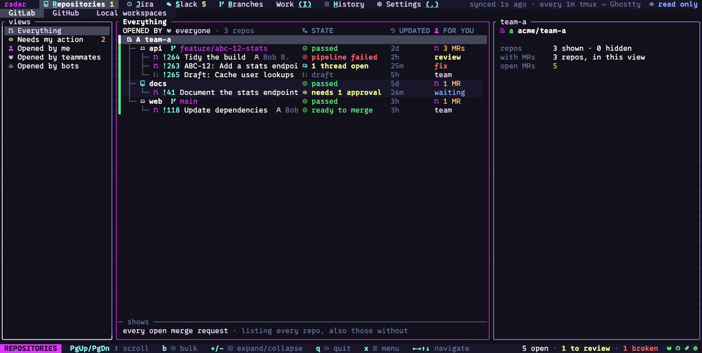
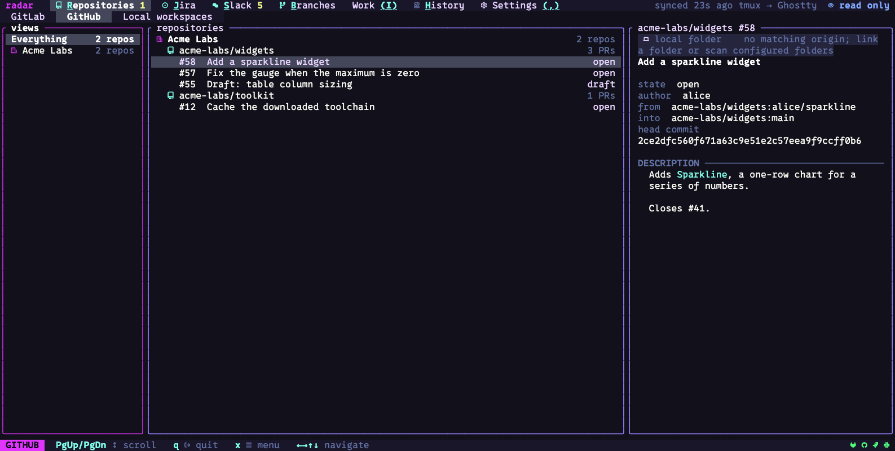
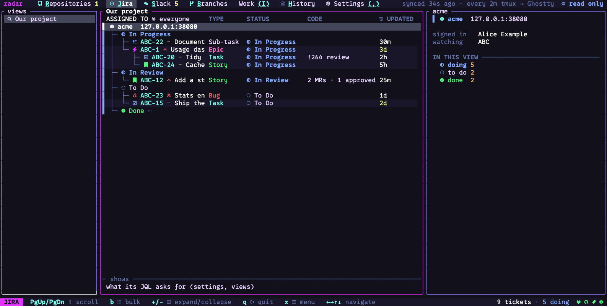
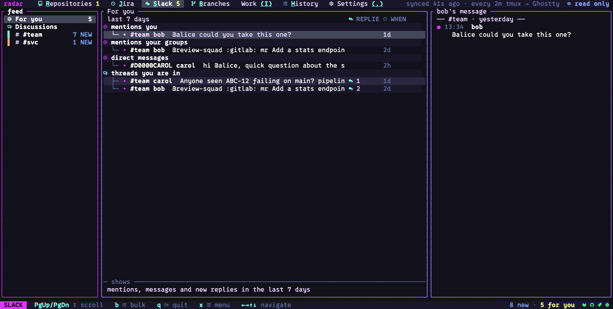
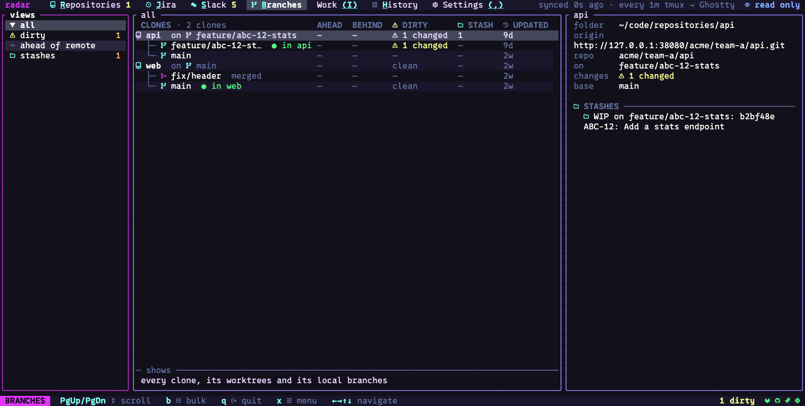
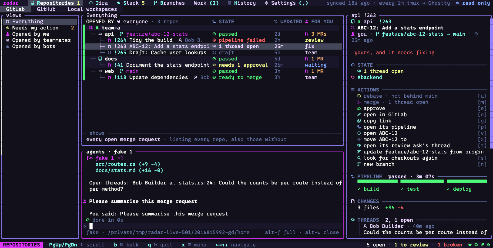

# radar

radar is a terminal workspace for developers who spend their day across GitLab, GitHub,
Jira and Slack. It shows your merge requests, pull requests, tickets and the Slack threads
about them on one screen, joined to each other and to the code checked out on your machine,
and it runs coding agents (Claude, Codex, GitHub Copilot) beside that work.

[Install](#install) · [Get started](docs/user-guide/quickstart.md) ·
[User guide](docs/user-guide/README.md) · [Documentation](docs/README.md) ·
[Releases](https://github.com/temet-ai/radar/releases) ·
[Help](docs/user-guide/troubleshooting.md)



## Install

radar is a single binary with its renderer built in, so it needs no Node or Python. It runs
in a terminal, including over SSH and inside tmux.

On macOS or Linux with Homebrew:

```sh
brew install temet-ai/radar/radar
```

Use the full name: Homebrew has an unrelated app called `radar`, and the short name
installs that one. Later releases come with `brew update && brew upgrade temet-ai/radar/radar`.

With [mise](https://mise.jdx.dev), add this to `mise.toml` and run `mise install` (the two
options let mise take prereleases, and on the day they come out):

```toml
[tools]
"github:temet-ai/radar" = { version = "latest", prerelease = true, minimum_release_age = "0s" }
```

Or download the archive for your platform from the
[releases page](https://github.com/temet-ai/radar/releases), check it against
`checksums.txt`, and put `radar` on your `PATH`. Builds exist for macOS (Apple Silicon and Intel) and Linux (x64 and arm64, glibc 2.35 or later). There is no Windows build yet; on
Windows, run the Linux build in WSL2.

For platform selection, checksum verification, PATH setup, upgrades and rollback, see
[Install and upgrade radar](docs/user-guide/install.md).

## First run

Run `radar --version` to check the installation, then `radar`. The first time, it walks you through setup: it asks before it looks for
tokens you already have, then sets up what you choose (your local code, each service, your
agents, and icons, theme and motion), and last asks which mode to run in. A service needs
a token (GitHub's public repositories need none); [Connect your services](docs/user-guide/connect.md) says which, with what access.
`radar setup` runs setup again. The [user guide](docs/user-guide/README.md) covers the
screens, keys, agents and settings. [Find a page](docs/user-guide/pages.md) links every
screen and detail tab to its guide.

## What it is for

The same piece of work is usually spread over several tools: a ticket in Jira, a merge
request in GitLab, a thread about it in Slack, a branch on your machine. radar links them.
A ticket shows its merge requests and the Slack threads that discuss it, a merge request
shows its ticket and where it is checked out, and you can open, check out, comment or ask an
agent from whichever one you are looking at.

Each service (GitLab, GitHub, Jira, Slack) and your local Git are a *part* of radar, with a
screen of its own. You can use one service or all of them; a part you do not set up has no
screen, and with no service at all the Git and Work screens still work. GitLab and GitHub
can be your own servers; Jira works with Atlassian Cloud sites.

### Merge requests (GitLab)

Your groups and repositories as a tree, with their open merge requests: which need your
review, which are yours and need fixing, which are ready to merge, and whose pipeline
failed. A merge request's page has its description, changes, threads and pipeline. From
there you can comment, approve, rebase, merge or check out its branch.



### Pull requests (GitHub)

Repositories, open pull requests, the checks on each pull request's head commit, and
Actions runs. GitHub is read-only for now.



### Tickets (Jira)

Your saved queries as views, tickets grouped by site and status, each with the merge
request linked to it. You can open, create, move, assign and comment on tickets.



### Chat (Slack)

Threads in the channels you watch, mentions of you and review asks, newest first, one line
a message. You can reply, react and mark threads read.



### Your local code (Git)

The clones on this machine, their worktrees and branches: which are dirty, ahead or behind
their remote, and your stashes. On a merge request or repository radar shows where it is
checked out, and opens it in your editor or a terminal.



### Work and history

Work is a list of your own tasks and of items you add from any screen. History is a record
on your machine of what radar did: syncs, items opened, and each write you confirmed or
declined.


### Agents

A dock under the middle pane runs Claude Agent (your own Claude Code), Codex or Copilot
sessions. `A` on a row starts a session with that item already described to the agent, and
`i` on a merge request asks an agent to review it locally. The agents are the `claude`,
`codex` or `copilot` programs, which you install and sign in to separately. Agent approval requests appear in the dock; what needs a fresh approval also
depends on the provider and any standing rules you have configured. Read the
[agent approval guide](docs/user-guide/agents.md) before running a session.



### Getting around

Every part is laid out the same way: views on the left, items in the middle, the selected
item's detail on the right, and a page for each item. `j` `k` or the arrows move, `tab`
goes to the next pane, `⏎` opens, `esc` goes back, a capital letter goes to a screen (`R`,
`J`, `S`, `B`), and `q` quits. The bottom line shows the keys that work where you are; `x`
lists them all.

### Writes and the mode

A write (a comment, an approval, a merge) is shown in full and sent when you confirm it. The
mode at the top right sets which writes radar may send: **read only** sends none, **write**
may add comments, replies, reactions and new items, and **edit** may also approve, resolve,
move, assign, rebase and merge. A click on the mode changes it. The mode covers what radar
sends; an agent's own commands go through the dock's approvals.

## Status

Radar is in alpha. Screens, keys and the config file can still change between releases.
The documentation on `main` follows development. For an installed release, use the
README and guides at its tag (the release page links its source); `radar --version`
prints your version and commit. A source tag alone does not mean its binaries have
been published.

## Privacy

radar's config, cache and history are local files. Connected services and agent providers
receive requests and the context needed for their features. Opened links, Git operations and
programs you launch can make network requests too. The Claude Agent SDK is fetched from
the npm registry on first use when it is not already cached.
[What radar stores and sends](docs/user-guide/privacy.md) lists each file and request, and
[SECURITY.md](SECURITY.md) says how to report a security problem.

## Contributing

[CONTRIBUTING.md](CONTRIBUTING.md) says what to send, how to build radar and how to run
its tests.

## Licence

MIT, see [LICENSE](LICENSE). `radar licenses` prints the licences of everything a release
carries ([THIRD-PARTY-NOTICES.md](THIRD-PARTY-NOTICES.md)).

radar is an independent project, not affiliated with or endorsed by Anthropic, OpenAI,
GitHub, GitLab, Atlassian or Slack. Their product names are their trademarks.
