# radar user guide

This guide shows how to set radar up and work in it. What radar is for, and how to install
it, are in the [README](../../README.md). For supported platforms, checksums, updates
and rollback, use [Install and upgrade radar](install.md).

This guide follows the source revision you are reading. Match its tag to
`radar --version` when using a published release; `main` can be ahead of the packages.

New to radar? Start with [Get started with radar](quickstart.md), a short walkthrough
using a local Git checkout. Use [Find a page](pages.md) for the complete screen and
tab directory, or read [Getting around](#2-getting-around) for shared controls.

**On this page**

1. [First run](#1-first-run)
2. [Getting around](#2-getting-around)
3. [The parts](#3-the-parts)
4. [Agents](#4-agents)
5. [Settings and the config file](#5-settings-and-the-config-file)
6. [The command line](#6-the-command-line)

Guides: [GitLab](gitlab.md), [GitHub](github.md), [Jira](jira.md), [Slack](slack.md),
[Branches](git.md), [Workspaces](workspaces.md), [Work](work.md) and [History](history.md).
For setup and configuration, use [Connect your services](connect.md), [Agents](agents.md),
[MCP and automatic local reviews](mcp-and-reviews.md) and [Settings](settings.md).
[Keys](keys.md), [What radar stores and sends](privacy.md) and
[When something looks wrong](troubleshooting.md) are the reference pages.

---

## 1. First run

Start radar:

```sh
radar
```

radar opens full screen in your terminal. For a moment a radar sweep finds each part it has,
with what each holds for you, and a new line greets you each start.

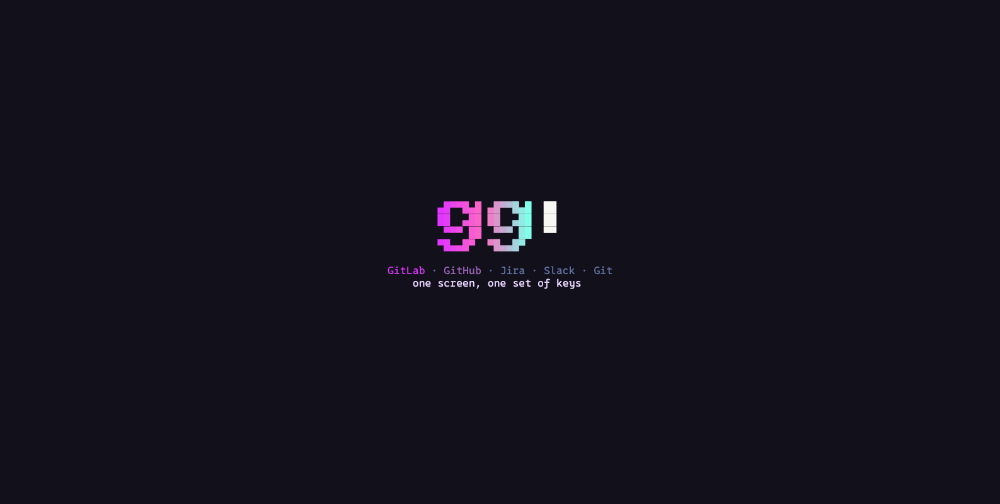

Any key skips it, and the screen under it takes that key. Skipped in the first second and a
half, its line shows on the status line for a few seconds instead. Terminals that can draw
pictures (kitty's graphics) get a sharper, pixel-drawn scope. `splash` under Settings,
General, colours turns it off.

### Setup

The first time (when there is no config file), radar walks you through setup. Each step is
one page: what you choose on the left, help for that step on the right, and `step n of m`
at the top. Nothing is sent to a service until you connect it.

1. **Welcome.** What radar is and what setup will do. Choose `yes, let's set it up`, or
   `not now` to go straight to radar.
2. **Look for keys?** radar asks whether it may look for keys you already have. It reads the
   *names* of variables such as `GITLAB_TOKEN` and `JIRA_…`, and whether the sign-in files of
   `glab`, `gh`, `claude` and `codex` exist, not their contents. Choose `yes, look` or
   `no thanks`. It asks every time setup runs.

   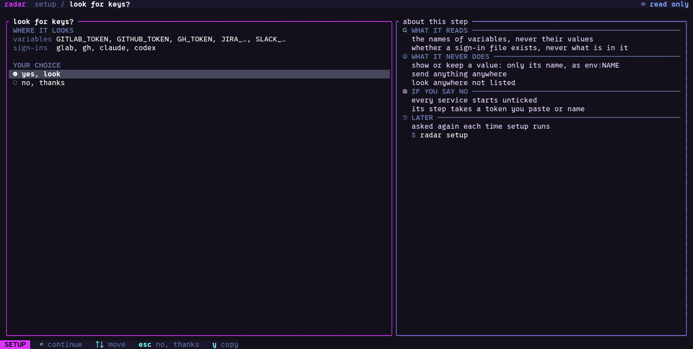

3. **Choose.** A list of what can be set up, under this machine, services, agents and
   optional. What the look found is ticked already. `space` ticks a row, `a` ticks all, `n`
   none; `⏎` starts at the row you are on, one step for each tick.

   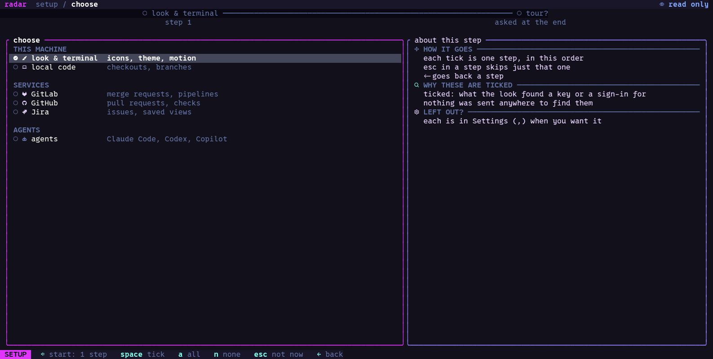

4. **One step per tick**, in the list's order:
   * **Local code**: the folders radar looks in for your Git checkouts. It offers folders it
     finds, such as `~/projects`.
   * **Each service** you ticked: its connection section from Settings, the same fields,
     with help beside it on how to get a token. [Connect your services](connect.md) has
     each one in full.

     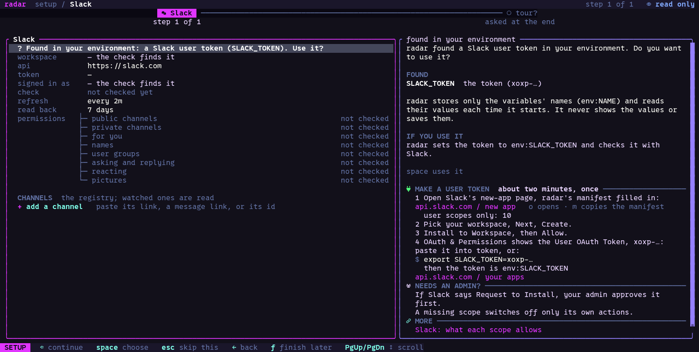

   * **Agents**: which of Claude Code, Codex and Copilot are installed and signed in, and
     which one new sessions use ([Agents](agents.md)).
   * **Look & terminal**: what radar found about your terminal, then the icons (`nerd` needs
     a Nerd Font; `plain` works in any font), the theme, and how much motion. `space`
     applies a choice at once.

     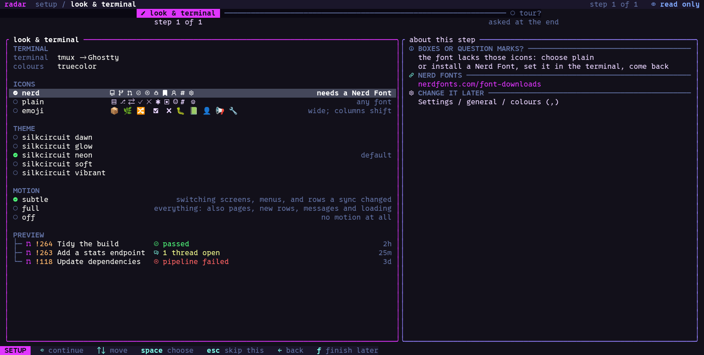

5. **Mode.** Which writes radar may send: read only, write or edit
   ([the mode](#the-mode)). Every setup ends with this step, and it cannot be skipped.
6. **Ready.** What was set up, where the config is saved, and the mode. Ready offers a short
   tour of the screens; `radar setup tour` shows it again.

   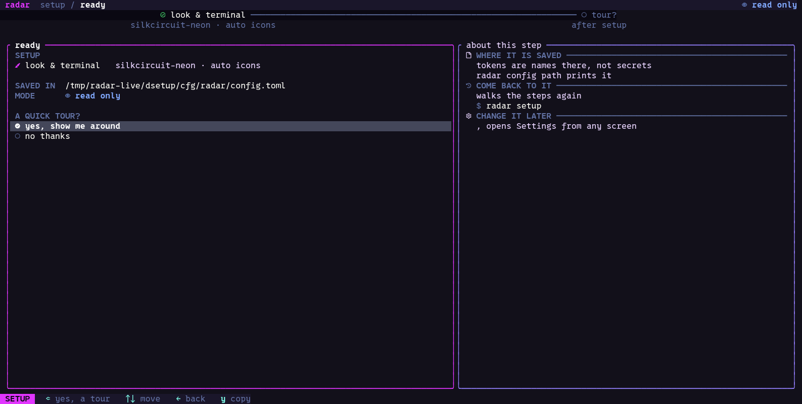

`esc` skips a step, `←` goes back one, and `f` leaves setup and keeps your answers; the
status line then says where you stopped. The rest of setup's keys are in
[Keys](keys.md#setup).

A part you have not set up is hidden from the screen tabs. Configure it in Settings
or run its setup step. Run setup again whenever you like, or open one step on its own:

```sh
radar setup            # from the start
radar setup gitlab     # one step: welcome, scan, choose, look, local, gitlab, github,
                       # jira, slack, agents, mode, ready, tour
```

Everything setup sets is also in Settings (`,`).

---

## 2. Getting around

### The screen

* **Top bar.** One tab per screen: Repositories, Jira, Slack, Branches, Work, History,
  Settings. A screen's key is the letter underlined in its name. On the right radar shows its
  [mode](#the-mode) and when it last synced.
* **Three panes.** Most screens have views on the left, the items in the middle, and the
  detail of the selected item on the right. `⏎` opens a detail page where the item has one;
  some local rows open a folder in your editor.
* **Status line.** The bottom line shows the keys that work where you are. Every key on it
  can be clicked.
* **Agent dock.** Supported list screens and Settings show sessions beneath the middle
  pane. Work and item pages omit the dock (see [Agents](#4-agents)).

### The key model

radar follows three rules, so you can guess keys.

1. **A key is underlined inside its word**: the `b` in b̲ulk, the `q` in q̲uit. A key that is a
   symbol (`↑` `↓` `⏎` `esc`) comes before its word.
2. **The same key does the same thing in the same kind of place.** `r` refreshes a list or an
   open page in every part. `o` opens the item in its service. `y` copies its link. `c`
   writes a comment where there is a discussion. Keys can differ between *kinds* of place.
3. **Everything can be reached from the menu.** `x` (or `?`) lists every key for where you
   are. Choose a row and radar presses its key.

Every key is listed in [Keys](keys.md).

### Menus

Press `x` and a menu opens beside the selection. It lists what you can do *here*, with the
key beside each row. A row that cannot be done now stays in the list, muted, with the reason
(for example "radar is read only" or "needs 1 approval").

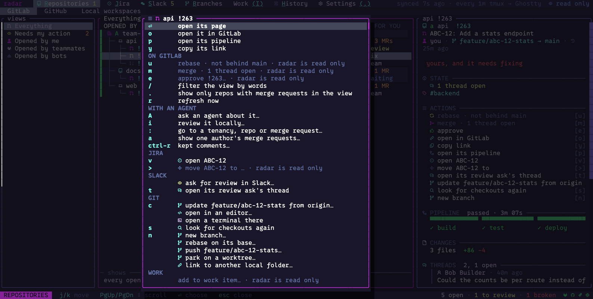

### Pages

`⏎` on a service item opens its **page**. A merge request has Overview, Changes,
Threads, Pipeline and Commits tabs. Linked Ticket/Tickets and Slack tabs appear when radar
has related information. `[` and `]` switch tabs; `esc` returns to the previous page or
the list with your place kept. [Find a page](pages.md) lists every page and tab.

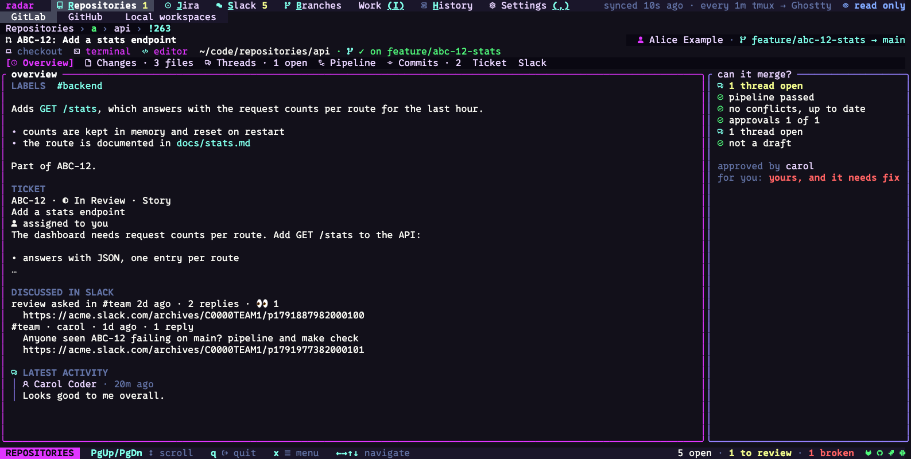

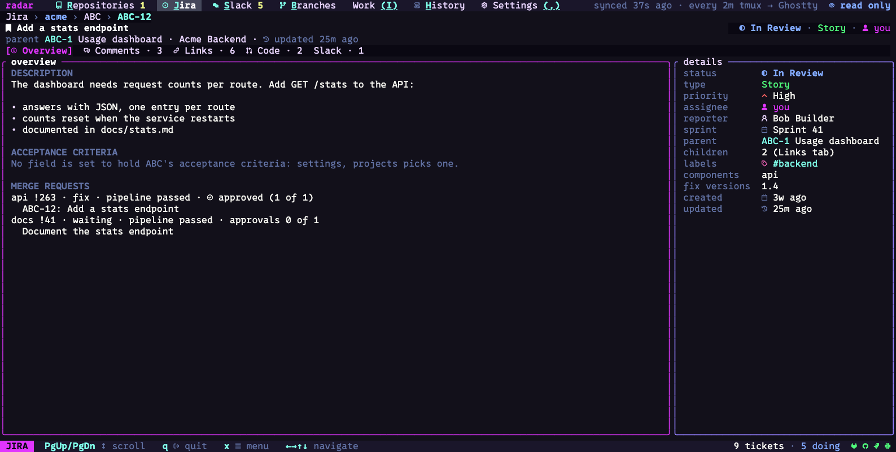

### Finding things

Press `ctrl-p` while navigating to open the **command palette**. Type words to find a
screen, Settings section, an available action or an item radar already has cached.
Choose with `↑` / `↓` and `⏎`; `esc` closes it. Searching does not fetch more service data.
Close a text editor or other menu first; those controls keep their own keys.

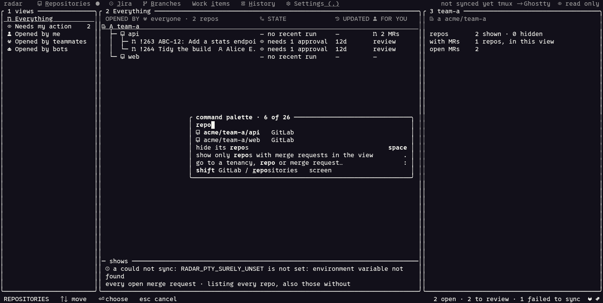

The picture uses an offline demonstration cache, so its status line reports that sync
credentials are unset. The palette can still find the cached items.

* `/` filters the list by words. In GitLab you can also write terms such as `state:merged`
  or `label:bug`.
* `:` goes to a group, repository or merge request in GitLab, or a ticket in Jira, by name,
  key or number.
* `a` shows one author's merge requests in GitLab, or one assignee's tickets in Jira.

### Recent notices

Press `~` while navigating to read notices retained during this radar session. Select a
notice with `↑` / `↓` and scroll its detail with `PgUp` / `PgDn`. `esc` or `~` closes the
list. Use this when a status message disappeared before you could read it.

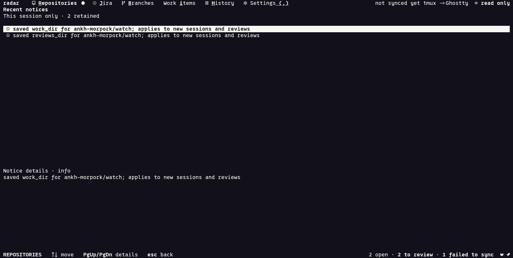

These notices disappear when radar closes. Press `H` for the persistent
[History](history.md), which records operations and their outcomes.

### The mouse

The mouse does what the keys do. What a click would act on is lit under the pointer. A click
selects, two clicks open, right-click on a row opens its `x` menu, and the wheel scrolls the
pane under the pointer. Right-click needs a terminal that passes right-clicks through;
`radar terminal`, and Settings, General, parts, show what radar detected.

Dragging selects text inside the pane it started in, and letting go copies it. The status
line says how it was copied (`copied 42 characters · wl-copy`, or `· terminal` when your
terminal's clipboard took it). In text, a double-click selects a word, a path or a link
whole, and a triple-click a line. [Keys](keys.md#mouse) has the rest.

### Links and pictures

Links in descriptions, tickets and messages are terminal hyperlinks: Ctrl-click (Cmd-click on
a Mac) opens one, in terminals that support them. Pictures in Slack threads, merge request descriptions and tickets currently appear
as a line naming the picture and its link. Open the link to view the image. The
Kitty-graphics splash is separate from these service-content images. Hyperlink and
image preferences are under Settings, General, colours; enabling images does not
add service-content rendering that the current renderer has not implemented.

Opening links and copying work on macOS, Linux (Wayland and X11), Windows under WSL2, inside
tmux and over SSH. Where radar cannot reach a browser itself (over SSH, say), it puts the
link on your clipboard through the terminal and says so on the status line. `$BROWSER` is
used first when set.

### The mode

The top bar shows radar's mode on the right. A click on it, or Settings, General, mode,
changes it.

| Mode | What radar may send |
|---|---|
| read only | no remote writes or local Work annotations; a remote write can still show its question, but `y` sends nothing |
| write | additions: comments, replies, reactions, review asks, new tickets |
| edit (the default) | also changes: approve, resolve, rebase, merge, move or assign tickets |

`RADAR_MODE=read-only radar` (or `write`, `edit`) sets the mode for one run.

Remote write actions show a confirmation before sending; `y` confirms and `e` returns to
editing where offered. Comments and replies use the shared small editor
([keys](keys.md#text-and-questions)); `ctrl-r` recovers retained text in GitLab, Jira and Slack.

The mode does not disable Settings or local Git changes such as checking out, creating
branches and deleting worktrees. Git pushes are mode-gated: a new remote branch needs
write mode, while updating an existing branch needs edit mode. Read the action's own
confirmation to see what will change.

---

## 3. The parts

Use [Find a page](pages.md) for the complete list of screens and nested tabs. Each guide
below includes a walkthrough, available actions and help with loading or empty states.

### GitLab

Press `R` and choose GitLab. Follow groups, repositories and merge requests; inspect
diffs, discussions, pipelines and job logs. The [GitLab guide](gitlab.md) covers all
pages and review actions, including linked Jira tickets and Slack threads.

### GitHub

Press `G`, or choose GitHub under Repositories. Read repositories, pull requests,
head-commit checks and Actions run attempts. The [GitHub guide](github.md) explains
what each result means and where to open job logs. GitHub operations in radar are read only.

### Jira

Press `J`. Browse tickets by saved query, site and status; read descriptions, comments,
links and connected work. The [Jira guide](jira.md) covers every ticket tab, creation,
comments, assignment and transitions.

### Slack

Press `S`. Choose For you, Discussions, Alerts or a watched channel. The
[Slack guide](slack.md) covers threads, links, replies, reactions, local read marks and
review-request drafts. [Automatic local reviews](mcp-and-reviews.md#start-reviews-from-slack)
can turn watched review requests into local reports.

### Git (Branches)

Press `B`. Inspect local clones, worktrees, branches and stashes. The [Branches guide](git.md)
explains checkout selection, editors and terminals, branch operations and cleanup.

### Workspaces

Press `W`, or choose Local workspaces under Repositories. The [Workspaces guide](workspaces.md)
explains related checkout folders, ticket notes and starting a ticket across repositories.

### Work

Press `I`. Create local tasks and connect service items through **add to work item…**.
The [Work guide](work.md) covers tasks, groups, filters, source bindings and evidence.

### History

Press `H` for recorded operations and outcomes. An item's action menu can open its own
history. The [History guide](history.md) explains event detail, operation scopes and
pagination; [privacy](privacy.md#files) explains what the journal stores.

---

## 4. Agents

radar runs Claude Agent, Codex and Copilot sessions in a dock beneath the middle pane of
supported list screens and Settings. Work and item pages omit the dock. `A` on supported GitLab,
Jira, Slack and Branches rows starts a session with that item's context; `i` on an open GitLab
merge request starts a local review. [Agents](agents.md) covers setup, conversations,
approvals, resume and terminal tabs.

[MCP and automatic local reviews](mcp-and-reviews.md) covers the shared context model for
external sessions and radar's integrated agents, Slack-triggered review intake, results
and global or per-repository save locations.

---

## 5. Settings and the config file

### Settings

Press `,`. Settings is a tree on the left, the section in the middle and an explanation of
the selected row on the right. Everything saves as you go.

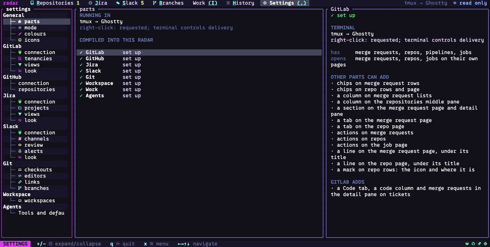

The [Settings guide](settings.md) describes all 27 sections, including provider defaults,
Git worktree templates and [repository-specific folders](settings.md#change-a-folder-for-one-repository).
The right pane names each row's config key and accepted values. Invalid values stay in
the editor with a reason.

### The config file

Run `radar config path` to find your TOML file and `radar config show` to print its
configuration. Settings saves completed changes; restart radar after hand-editing the
file. The [config reference](settings.md#the-config-file) gives the location, environment
overrides and an example. Treat the output as sensitive if you store tokens in the file.

### Colours

Choose the palette, motion and icon pack in **General / appearance**. Use
**General / colours** for individual colour slots, terminal colour depth, the splash,
hyperlinks, images and pointer. Slot overrides survive a palette change.
[Appearance and colour settings](settings.md#appearance) lists the choices.

### Icons

If icons appear as empty boxes, choose `unicode` in **General / appearance**, or install
a Nerd Font. **General / icons** changes individual glyphs; `r` restores the pack's glyph.
The [Icons reference](settings.md#icons) explains custom packs and the `radar icons` commands.

### The start line

Each start shows a new line under the mark: a joke, a tip, or something radar already holds
for you ("3 merge requests wait for your review"). radar does not ask a service for a line.

```toml
[start_lines]
show = true                       # false: no line at all
tips = true                       # false: no tips
off = ["time"]                    # groups not shown
mine = ["Coffee first."]          # your own lines
weights = { mine = 30 }           # how often each group is drawn
```

The lines and their groups are listed in the file radar ships
([`start-lines.toml`](../../crates/radar-core/assets/start-lines.toml)). Your own file,
`~/.config/radar/start-lines.toml`, may add lines in the same form.

### Refresh and idle

Services refresh while radar is active; connection settings expose configurable intervals
where supported. By default, radar pauses after 30 idle minutes; input resumes it. Enabled
automatic review intake or active background work can keep refreshing through idle time.
Change the timeout in Settings, General, mode (`pause if idle`). `z` pauses by hand and
stays paused until you press `z` again. Each service guide explains its refresh behavior.

---

## 6. The command line

Several parts print their lists without opening the screen, for scripts or a quick look.
The part commands (`gitlab`, `github`, `jira`, `slack`) send no writes, and use the same
config and tokens as the screen.

```sh
radar gitlab list [--view NAME] [--filter TEXT] [--json]
radar gitlab show '!263' [--json]        # or repo!263 when several repositories have one
radar github list [--json]
radar jira list [--view NAME] [--site NAME] [--filter TEXT] [--json]
radar jira show WATCH-12 [--site NAME] [--json]
radar slack list [--view CHANNEL] [--filter TEXT] [--json]
radar slack catchup [CHANNEL] [--json]
radar slack cache-recovery               # exports quarantined cache JSON locally
radar parts                             # lists the parts compiled into this binary
radar config path | show
radar setup [STEP]                       # opens radar on setup, from the start or one step
radar icons list | export PACK | path
radar mcp [--workspace /absolute/path]   # stdio bridge to a running radar host
radar terminal                           # the terminal layers radar detected
radar licenses                           # radar's licence and the licences of what it carries
radar work id | apply | handoff | items | events | tag | change | resolve
```

`--filter` takes the same words as `/` in the screen. `radar work` is for tools: each
subcommand except `id` takes `--stdin` and reads one JSON object on standard input. `id`
prints a new UUID; `apply` records local work annotations; `handoff`, `items`, `events`,
`tag`, `change` and `resolve` look up what was recorded. `radar work --help` describes them.

For Slack cache recovery semantics and privacy precautions, see
[Slack cache and recovery](../slack-cache.md).
