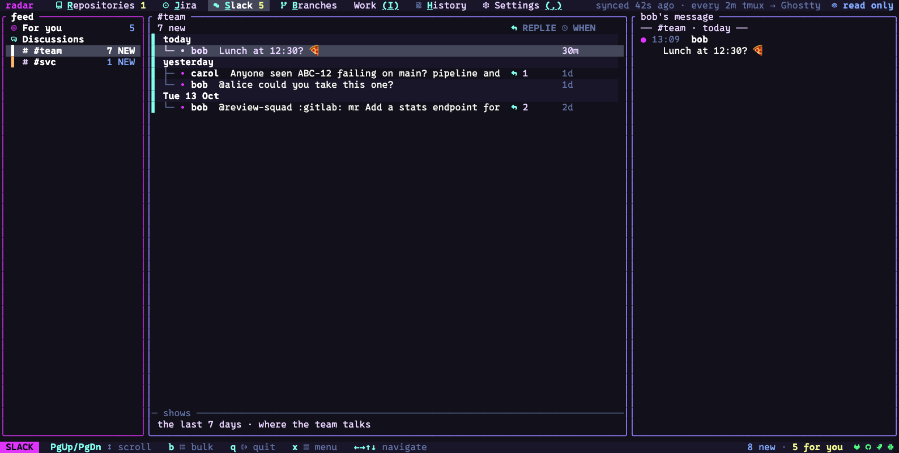
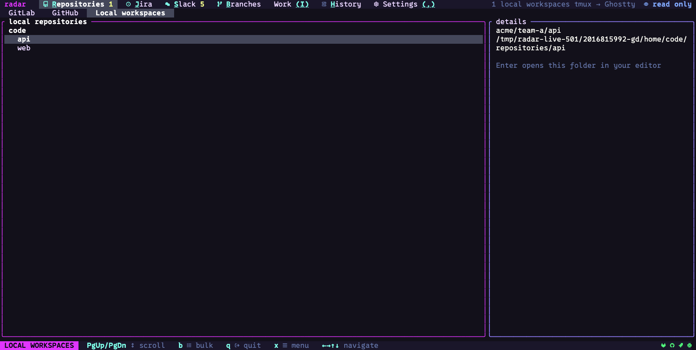
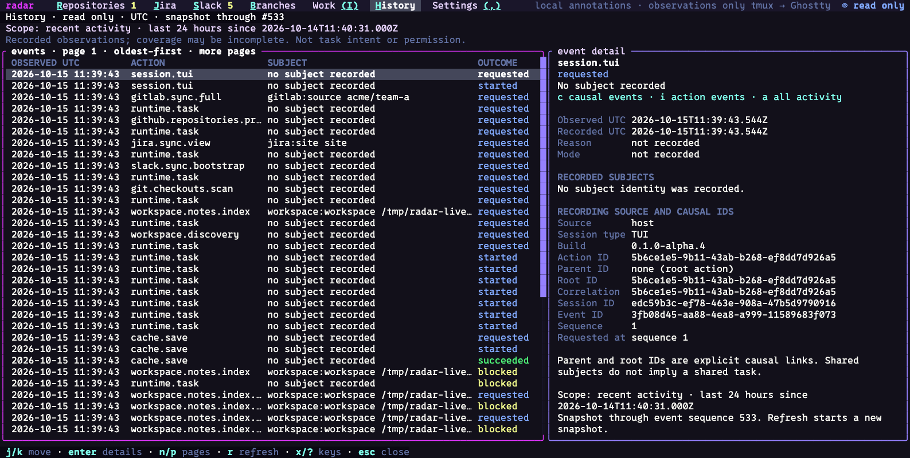
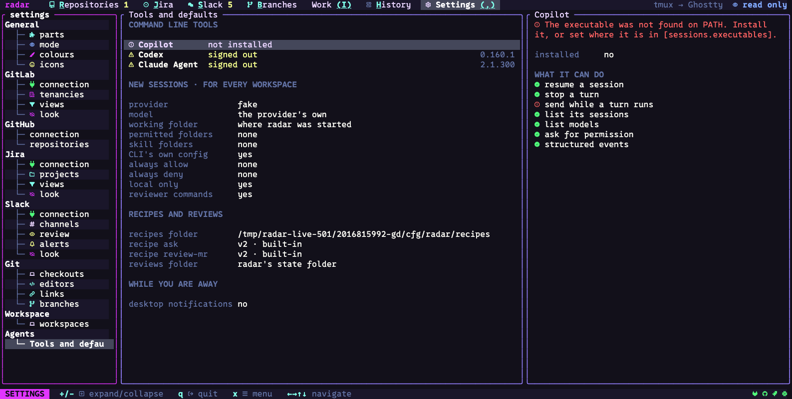

# radar user guide

radar is a terminal workspace. It puts the work you follow across GitLab, GitHub, Jira,
Slack and your local Git checkouts on one screen. It can also run
coding agents (Claude Agent, Codex, Copilot) next to that work, so you can hand an agent a
merge request, a ticket or a Slack message.

radar is a single program. It runs in your terminal, keeps a small cache on your machine,
and talks to each service with your own token. Every change it makes (a comment, an
approval, a merge) is shown in full and asked first, and you can run it in a mode where
it changes nothing at all.


radar is an alpha. Expect rough edges, and expect it to change between releases.

**On this page**

1. [Install](#1-install)
2. [First run](#2-first-run)
3. [Connect your services](#3-connect-your-services)
4. [Getting around](#4-getting-around)
5. [The parts](#5-the-parts)
6. [Agents](#6-agents)
7. [Settings, themes and the config file](#7-settings-themes-and-the-config-file)
8. [The command line](#8-the-command-line)
9. [When something looks wrong](#9-when-something-looks-wrong)

More pages: [Keys](keys.md) (every key on one page), [Connect your services](connect.md),
[Agents](agents.md), [What radar stores and sends](privacy.md) and
[When something looks wrong](troubleshooting.md).

---

## 1. Install

radar is one file. Everything it needs, including the screen drawing and the Claude Agent
connector, is inside it. You do not need Node, Rust or anything else. The first time you
start a Claude session, radar downloads Anthropic's Claude Agent SDK (about 1.6 MB) from the
npm registry, checks it against the version radar was built with, and keeps it in its cache
folder; after that it needs no download.

### Homebrew (macOS and Linux)

```sh
brew install temet-ai/radar/radar
```

Use the full name. Homebrew also has an unrelated app called `radar`, and `brew install
radar` installs that one even after `brew tap temet-ai/radar`.

Upgrade later with:

```sh
brew update && brew upgrade temet-ai/radar/radar
```

### mise (macOS and Linux)

Add this to your `mise.toml`:

```toml
[tools]
"github:temet-ai/radar" = { version = "latest", prerelease = true, minimum_release_age = "0s" }
```

Then run:

```sh
mise install
```

Upgrade later with `mise upgrade`. `prerelease = true` is needed because every release
so far is an alpha.

### Download the file yourself

Go to the [radar releases page](https://github.com/temet-ai/radar/releases),
download the archive for your platform, unpack it, and put the `radar` file on your `PATH`.
Each release lists a `checksums.txt`; check the archive against it.

Archives are published for:

| Platform | Notes |
|---|---|
| macOS, Apple Silicon and Intel | |
| Linux, x64 and arm64 | glibc systems (built on Ubuntu 22.04). Older distributions are not covered |
| Windows | No Windows build yet; run the Linux build in WSL2 |

### Check it works

```sh
radar --version
radar config path
```

The first prints the version and build. The second prints where radar keeps its config
file (the file does not need to exist yet).

### The only extra requirement

Install one of these only if you want that agent inside radar:

| Agent | Program radar looks for |
|---|---|
| Claude Agent (runs your Claude Code) | `claude` |
| Codex | `codex` |
| GitHub Copilot | `copilot` |

Sign in to the agent's own program as you normally do. radar never reads, stores or passes
on an agent's login: each agent runs as your own `claude`, `codex` or `copilot`, signed in
your way (a subscription or an API key), and that vendor's terms apply to its use. For
heavy or unattended use of Claude, Anthropic recommends an API key.

radar is an independent project. It is not affiliated with, endorsed by or sponsored by
Anthropic, OpenAI or GitHub. Claude and Claude Code are trademarks of Anthropic; Codex is a
trademark of OpenAI; GitHub and Copilot are trademarks of GitHub.

---

## 2. First run

Start radar:

```sh
radar
```

radar opens full screen in your terminal. For a moment a radar sweep finds each part it has,
with what each holds for you, and a new line greets you each start.


Any key skips it, and the screen under it takes that key. Skipped in the first second and a
half, its line shows on the status line for a few seconds instead. Terminals that can draw
pictures (kitty's graphics) get a sharper, pixel-drawn scope. You can turn the splash off
under Settings, General, colours (`splash`).

### Setup

The first time (when there is no config file), radar walks you through setup. Each step
is one page: what you choose on the left, help for that step on the right, and a rail across
the top that shows where you are. Nothing is sent to a service until you connect it.

1. **Look for keys?** radar asks whether it may look for keys you already have. It reads
   only the *names* of variables such as `GITLAB_TOKEN` and `JIRA_…`, and whether the
   sign-ins of `glab`, `gh`, `claude` and `codex` exist, never their contents. Choose
   `yes, look` or `no, thanks`. It asks every time setup runs; a yes is never remembered.

   

2. **Choose.** A list of what can be set up, under this machine, services and agents. What
   the look found is ticked already. `space` ticks a row, `a` ticks all, `n` none; `⏎`
   starts, one step for each tick.

   

3. **One step per tick**, in the list's order:
   * **Look & terminal**: what radar found about your terminal, then the icons (`nerd` needs a
     Nerd Font; `plain` works in any font), the theme, and how much motion. A preview shows
     the choice as you move, and `space` applies it at once.

     

   * **Local code**: the folders radar looks in for your git checkouts. It offers folders it
     finds, such as `~/projects`, and needs no extra permission.
   * **Each service** you ticked: its connection section from Settings, the same fields, with
     help beside it on how to get a token (`o` opens the token page, `y` copies a command). A
     token found in your environment is offered as a question; `space` takes it.
     * GitLab: the server and token, then FOLLOW, the groups or repositories to follow. `glab`
       as the token uses the `glab` program's sign-in.
     * GitHub: SIGN IN: public only, `gh`'s sign-in, or a token.
     * Jira: each site with its projects; `p` picks the projects you looked at lately.
     * Slack: the token and what it may do, then CHANNELS. `m` copies radar's Slack app
       manifest and `o` opens Slack's new-app page with it filled in.

     

     [Connect your services](connect.md) has each one in full.
   * **Agents**: which of Claude Code, Codex and Copilot are installed and signed in, and
     which one new sessions use. The help beside it has the commands to install or sign in
     one; `y` copies a command.
4. **Ready.** What was set up, where the config is saved, and the [mode](#mode-what-radar-may-change)
   radar is in. Ready offers a short tour of the screens; `radar setup tour` shows it again.

   

The keys in setup, also on its status line:

| Key | Does |
|---|---|
| `⏎` | continue |
| `esc` | skip this step |
| `←` | back a step (a click on a stop on the rail goes back to it) |
| `space` | choose the row |
| `f` | finish later: keeps your answers and leaves setup; the status line says where you stopped |

A part you have not set up says so on its screen; `s` there walks its setup step, and
`⏎` opens its section in Settings.

Run setup again whenever you like, or open one step on its own:

```sh
radar setup            # from the start
radar setup gitlab     # one step: scan, choose, look, local, gitlab, github, jira, slack, agents, ready, tour
```

Everything setup sets is also in Settings (`,`).

### radar offers the tokens it finds

Besides setup's look, each service's connection section in Settings checks your environment
variables. When it finds something that looks like a token for that service, it asks you:

> ? Found in your environment: a Slack user token (SLACK_TOKEN). Use it?

Press `⏎` to use it (in setup, `space`). radar then saves **only the variable's name** (as
`env:SLACK_TOKEN`) and reads the value every time it starts. It never shows the
value and never copies it into the config file. The question stays until the service is
signed in.

What radar looks for:

| Service | It offers |
|---|---|
| GitLab | `GITLAB_TOKEN`, when the token is set to something else and its value is 20 characters or more (`env:GITLAB_TOKEN` is the default, so it is usually already in use) |
| Jira | a set of variables with a common prefix that has `JIRA` or `ATLASSIAN` in it: a `_BASE_URL` (or `_URL`), an `_EMAIL` (or `_USERNAME`, `_USER`) and a `_TOKEN` (or `_API_TOKEN`) |
| Slack | a variable whose name has `SLACK` and `TOKEN`, and whose value starts with `xoxp-` (a user token) |
| GitHub | nothing in Settings; setup's look notices `GITHUB_TOKEN`, `GH_TOKEN` and `gh`'s sign-in, and its GitHub step offers `gh` |

### The screen

* **Top bar.** One tab per screen: Repositories, Jira, Slack, Branches, Work, History,
  Settings. On the right radar shows its [mode](#mode-what-radar-may-change) and when it last synced.
* **Three panes.** Most screens have a list on the left (views, groups), the items in the
  middle, and the detail of the selected item on the right.
* **Status line.** The bottom line shows the keys that work where you are. Every key on it
  can be clicked.
* **Agent dock.** When you start an agent, it appears under the middle pane (see [Agents](#6-agents)).

---

## 3. Connect your services

Every service has a **connection** section in Settings (press `,`). They all look alike: a
question if radar found a token in your environment, where the service is, the token (as
`env:NAME` or the token itself), who you are signed in as, a check, and how often radar
refreshes. A token you type is saved in the config file and shown masked; `env:NAME` stores
only the name.

The page [Connect your services](connect.md) says what each one needs:

| Service | You need |
|---|---|
| GitLab | a personal access token with the `read_api` scope; a server address; the groups or repositories to follow |
| GitHub | nothing for public repositories; for private ones `gh`'s sign-in or a token that can read them; the repositories to follow (read only) |
| Jira | your site, your Atlassian email and an API token; the projects to follow |
| Slack | a user token (`xoxp-`) with the scopes listed there; the channels to watch |


---

## 4. Getting around

### Screens

Each screen has a letter, underlined inside the screen's name on the top bar.

| Key | Screen |
|---|---|
| `R` | Repositories (GitLab; `G` for GitHub; `W` for local workspaces) |
| `J` | Jira |
| `S` | Slack |
| `B` | Branches (local Git) |
| `I` | Work |
| `H` | History |
| `,` | Settings |

You can also click a tab, or press `↑` from the top of any pane to reach the top bar, then
`←` `→` to switch and `↓` to go back in.

### The key model

radar follows three rules, so you can guess keys.

1. **A key is underlined inside its word**: the `b` in b̲ulk, the `q` in q̲uit. A key that is a
   symbol (`↑` `↓` `⏎` `esc`) comes before its word.
2. **The same key does the same thing in the same kind of place.** `r` refreshes a list or an
   open page in every part. `o` opens the item in its service. `y` copies its link. `c`
   writes a comment where there is a discussion. Keys can differ between *kinds* of place, not
   between parts.
3. **Everything can be reached from the menu.** `x` (or `?`) lists every key for where you
   are. Choose a row and radar presses its key.

The basics, which work everywhere:

| Key | Does |
|---|---|
| `↑` `↓` `←` `→` (or `k` `j` `h` `l`) | move |
| `tab` | next pane |
| `1` `2` `3` | the pane by number |
| `⏎` | go in: open the row's page |
| `esc` | go back one level; close a menu; clear a filter |
| `PgUp` `PgDn` | scroll the detail pane |
| `x` or `?` | the menu for where you are |
| `b` | bulk actions on everything shown |
| `/` | filter the list |
| `:` | go to a group, repository or merge request by typing part of its name or number |
| `r` | refresh |
| `o` | open in the service (browser) |
| `y` | copy the link |
| `z` | pause or resume refreshing |
| `q` | quit |
| `ctrl-c` | quit from anywhere |

The rest are in [Keys](keys.md).

### Menus

Press `x` and a menu opens beside the selection. It lists only what you can do *here*, with
the key beside each row. A row that cannot be done now stays in the list, muted, with the
reason (for example "radar is read only" or "needs 1 approval").


### Pages

`⏎` on a row opens its **page**. A page has tabs. A merge request has Overview, Changes,
Threads, Pipeline, Commits and Ticket. Switch tabs with `[` and `]`, or go to the tab row
with `↑` and use `←` `→`. `esc` goes back.


### Finding things

* `/` filters the list by words. In GitLab you can also write terms such as `state:merged`
  or `label:bug`.
* `:` jumps to a group, repository or merge request by name or number.
* `a` shows one author's merge requests (one assignee's tickets in Jira).

### The mouse

The mouse does what the keys do.

* What a click would act on is lit under the pointer.
* Click a row to select it, click twice to open it, click a tab to switch.
* Every key on the status line can be clicked.
* The wheel scrolls the pane under the pointer.
* Right-click a row to open its `x` menu. Right-click another row to move the menu;
  right-click empty space to close it. Your terminal must pass right-clicks through:
  `radar terminal` shows what radar detected, and so does Settings, General, parts.
* Drag to select text. When you let go, it is copied, and the status line says how
  (`copied 42 characters · wl-copy`; `· terminal` when your terminal's clipboard took it).
  A selection stays in the pane it started in: it never reaches into the pane beside it, and
  borders, titles, the top bar and the status line are not part of it. Dragging out of the
  pane stops at its edge.
* In text (a description, a document, a transcript) double-click selects a word, a path or a
  link whole, and triple-click a line. On a list or tree row, double-click still opens the row.
* With a selection showing, `shift`+arrows move its end, `shift`+`Home`/`End` go to the row's
  ends, and `ctrl+c` copies it again. Any other key, or a click elsewhere, clears it.
* While a drag selects, the status line names the key that makes your terminal select its own
  text instead of radar: `shift` (`option` in iTerm2, `fn` in Terminal.app).

### Links and pictures

Links in descriptions, tickets and messages are terminal hyperlinks: Ctrl-click (Cmd-click on
a Mac) opens one, in terminals that support them. Pictures in Slack threads, merge request
descriptions and tickets are drawn in the terminal where it supports kitty, sixel or iTerm2
graphics; elsewhere a line names the picture and its link. Both can be set under Settings,
General, colours.

Opening links and copying work on macOS, Linux (Wayland and X11), Windows under WSL2, inside
tmux and over SSH. Where radar cannot reach a browser itself (over SSH, say), it puts the link on your
clipboard through the terminal and says so on the status line. `$BROWSER` is used first when set.

### Mode: what radar may change

The top bar shows radar's mode on the right. Click it, press `x` then `mode…`, or use Settings,
General, mode.

| Mode | What radar may do |
|---|---|
| read only | nothing on a service. A write still shows its question, and `y` sends nothing |
| write | add things: comments, replies, reactions, review asks, new tickets |
| edit (the default) | also change what is there: approve, resolve, rebase, merge, move or assign tickets |

Set a mode for one run with `RADAR_MODE=read-only radar` (or `write`, `edit`).

Every write is asked first. radar shows everything it will send, and nothing goes until you press
`y`; `e` goes back to editing. Text you decline is kept, and the key that wrote it brings it
back. Text is typed in the same small editor everywhere: `⏎` new line, `ctrl-s` review and
send, `esc` stop.

---

## 5. The parts

Each part is one service. They follow one pattern: views on the left, items in the middle,
detail on the right, and a page for each item.

### GitLab

Press `R`, source GitLab. This is the merge request screen.


* **Left:** views, such as "Everything", "Needs my action", "Opened by me".
* **Middle:** a tree of your groups, repositories and open merge requests, with state (needs
  approval, ready to merge, pipeline failed), age and what is waiting for you.
* **Right:** detail of the selected group, repository or merge request, and its actions.

Views show open merge requests unless a filter says otherwise. `state:merged`,
`state:closed` or `state:all` add merged and closed ones from the last 14 days (change the
number of days in the GitLab connection settings).

On a merge request:

| Key | Does |
|---|---|
| `⏎` | open its page |
| `u` | rebase onto the target (offered when it is behind) |
| `m` | merge (offered when GitLab would take it) |
| `e` | approve, or take your approval back (on the page this is `a`) |
| `c` | check out its branch (when the repository is on this machine) |
| `p` | open the pipeline |
| `o` `y` | open in GitLab, copy the link |

In a view, `.` shows only the repositories that have merge requests in it, and back. In a diff,
`n` `N` go to the next and previous file and `}` `{` to the next and previous hunk. On a job's
log, `/` searches, `n` `N` step through matches, `space` folds a section, `g` goes to the start
and `c` copies the lines around the first error.

Text you decline to send is kept; `ctrl-r` lists it so you can copy it back or drop it (the same
in Jira and Slack).

A key that cannot work now stays in the `x` menu with the reason. Pipelines and job logs have
their own pages. After the first sync, radar asks GitLab only for what changed; `r` fetches
everything again.

### GitHub

Press `G` (or `R` and pick GitHub). Read only: repositories, open pull requests, the checks on
a pull request's head commit, and Actions runs.


`⏎` opens a page, `esc` goes back, `r` refreshes. radar does not rerun, cancel, review or merge
anything on GitHub. "No checks" is never shown as "passed", and a list radar could not read in
full says so.

### Jira

Press `J`. Views are your saved queries. The middle pane is a tree: site, then status, then
tickets. A ticket row shows its type, status, the merge request linked to it and its age.


| Key | Does |
|---|---|
| `⏎` | open the ticket |
| `n` | new ticket |
| `t` | move the ticket to another status |
| `i` | assign it to me |
| `c` | comment |
| `a` | show one assignee's tickets |
| `:` | go to a ticket by its key or words |
| `A` | ask an agent about the ticket |
| `Y` | copy the ticket's key (`y` copies the link) |

Moves, assignments and new tickets are asked first and need edit mode (a new ticket needs
write mode).

### Slack

Press `S`. Slack shows the threads in the channels you watch, mentions of you, and review asks,
newest first. Messages read like a compact chat: one line a message, with the author left blank
when the same person writes again within five minutes.




| Key | Does |
|---|---|
| `⏎` | open the thread |
| `c` | reply or write a message |
| `m` | mark read up to the selected message (radar's own mark; nothing is sent to Slack) |
| `e` | react to a message |
| `v` | on a review ask: review its linked merge request locally |
| `A` | ask an agent about the message |
| `o` `y` | open in Slack, copy the link |

On a review ask you are drafting, `p` posts it, `e` edits the words for the selected item, `d`
takes that item out and `n` drops the draft.

`:name:` emoji are shown as emoji. For a roomier layout, set Slack's `density` to `cozy` in
Settings, Slack, look.

### Git (Branches)

Press `B`. This is your local clones, their worktrees and their branches, with how far each is
ahead of or behind its remote, which are dirty, and your stashes.


* **Left:** All, Dirty, Ahead of remote, Stashes.
* **Middle:** a tree of clone, then worktrees, then branches.

`d` deletes a branch or worktree (radar asks, says what would be lost, and will not delete the
current branch). `r` refreshes. The bulk menu (`b`) has "prune merged and gone".

Tell radar where your code is: Settings, Git, **checkouts**, add the folders you keep clones in.
radar then shows, on a merge request or repository, where it is checked out. There you can check
out the merge request's branch (`c`), open an editor (`e`), open a terminal (`t`) and look
again (`s`). Editors per project type are under Settings, Git, **editors**. Checkouts, editors
and terminals work in every mode; pushing is a write and follows the mode.

### Workspaces

Press `R`, then `W` (the "Local workspaces" source). A workspace is a top folder that holds
your clones, for example `~/work/acme`. Add them in Settings, Workspace, **workspaces**. radar also
offers folders it finds, as a question; it never adds one by itself.



A workspace lets you start work on a ticket: you choose the ticket's repositories, and radar makes
the branches (or parked worktrees) and a notes file for it, asking first.

### Work

Press `I`. Work is a list of your own local work items: tasks you create, and things you add
from a service's `x` menu (**add to work item…**). It is a notebook of your own annotations.
radar infers nothing: no labels or links appear unless you made them. Press `n` to create a task.


### History

Press `H`. radar keeps a private journal on your machine of what it did and what happened: syncs,
checks, opens, and every write you confirmed or declined. History shows it.



* It opens on the last 24 hours. When a filter is set, `a` clears it and shows all recorded activity.
* The list is oldest first, 50 events at a time: `n` next page, `p` previous, `r` a fresh snapshot.
* `j` `k` choose a row, `tab` moves to its detail, `esc` goes back.
* From any item's `x` menu, **history for selected item** shows just that item.

The journal does **not** record typed text, drafts, clipboard contents or credentials. It
records the kind of operation, the item involved and the outcome. It is a record of what radar
saw, not a promise of complete coverage. Keep the file private: paths and item identities still
say something about your work.

### Settings

Press `,`. Settings is a tree on the left, the section in the middle and an explanation of the
selected row on the right. Everything saves as you go.


| Group | Sections |
|---|---|
| General | parts, mode, colours, icons |
| GitLab | connection, tenancies, views, look |
| GitHub | connection, repositories |
| Jira | connection, projects, views, look |
| Slack | connection, channels, review, alerts, look |
| Git | checkouts, editors, links, branches |
| Workspace | workspaces |
| Agents | tools and defaults |

`parts` shows which parts this radar has, whether each is set up, and the terminal radar detected.
`mode` sets read only, write or edit, and the pause when idle. `colours` and `icons` are in
[section 7](#7-settings-themes-and-the-config-file).

Settings explain themselves: the right pane says what a row does, what it accepts and which
config key it writes. A bad value is refused with a reason. `<` and `>` move a row up or down
where order matters (views, for example).

---

## 6. Agents

radar can run coding agent sessions (Claude Agent, Codex, GitHub Copilot) in a dock under the
middle pane, on every screen. A session is one conversation with one agent. radar can start one
with an item already described to it. You need the agent's own program (`claude`, `codex` or
`copilot`) installed and signed in. Claude Agent runs through your own Claude Code login.


| Key | Does |
|---|---|
| `` ` `` (backtick) | show the dock |
| `ctrl-t` | start a new session |
| `alt-f` | the dock takes the whole middle column, and back |
| `alt-w` | close the session tab showing (`ctrl-w` too, while the composer is empty) |
| `alt-←` `alt-→` | previous / next session tab |
| `alt-m` | choose the model for the session |
| `alt-s` | choose a session to open |
| `alt-o` | fold or open the latest tool call |
| `esc` | while a turn runs, stop it |
| `A` | on a row: ask an agent about it |
| `i` | on a merge request: review it locally (nothing is posted) |

Nothing an agent wants to run is approved for you: the dock shows the exact command, path or
diff and waits for you. The page [Agents](agents.md) covers the dock, approvals, sending an
item to an agent and the agent settings.



---

## 7. Settings, themes and the config file

### The config file

```sh
radar config path     # where it is
radar config show     # what radar would write, in full
```

It is a TOML file at `~/.config/radar/config.toml` (or `$XDG_CONFIG_HOME/radar/config.toml`), on
macOS too. radar writes it after each completed change in Settings, so you rarely need to edit it.
You may; radar reads it when it starts. The tables are named after the parts: `[gitlab]`,
`[github]`, `[jira]`, `[slack]`, `[git]`, `[workspace]`, `[sessions]`, `[theme]`, `[general]`,
and `[icons]`.
Every row in Settings names its key in the right pane (for example `config: [gitlab] url`).

A small example:

```toml
[gitlab]
url = "https://gitlab.com"
token = "env:GITLAB_TOKEN"

[general]
mode = "read-only"     # or "write" or "edit"
idle_minutes = 30      # 0 never pauses

[theme]
palette = "silkcircuit-neon"
motion = "subtle"
```

### Colours

Settings, General, **colours** has a palette picker (39 palettes) and every colour slot as a
hex value, such as `#e135ff`. Colours you set stay set when you change the palette.

| Setting (`[theme]`) | Values |
|---|---|
| `palette` | a palette name |
| `motion` | `subtle` (the default), `full`, `off` |
| `splash` | `auto`, `off` |
| `hyperlinks`, `images`, `pointer` | `auto`, `on`, `off` |
| `icons` | `auto`, `nerd`, `unicode`, `emoji`, `off`, or your own pack |
| `colors` | `auto` (detect), `truecolor`, `256`, `16`, `none`: how many colours radar uses |

**Motion.** `subtle` fades a screen in, sweeps menus open and makes rows that a sync changed
glow for a moment. `full` adds sliding pages, rows sweeping in and a shimmer on panels waiting
for data. `off` has none. A key always acts at once. Motion is off over SSH, below full colour,
and on terminals too slow to draw it.

### Icons

radar draws icons beside rows, states, tabs and menus. `auto` picks `nerd` (Nerd Font symbols) in
terminals that bring them (Ghostty, kitty, WezTerm) and `unicode` elsewhere and over SSH.
If you see empty boxes, set the pack to `unicode`, or install a Nerd Font.

Settings, General, **icons** lists every icon: `⏎` types your own, `r` gives it back to the
pack. You can also make a whole pack:

```sh
radar icons list                    # every icon and its glyph
radar icons export nerd > mine.toml # a pack as a start
radar icons path                    # the folder your packs go in
```

A pack can `extends` another and set only the icons it wants. Icons you change in Settings are
saved in the config file's own `[icons]` table (an icon's name and your glyph); they go on top of
the chosen pack.

### The start line

Each start shows a new line under the mark: a joke, a tip, or something radar already holds
for you ("3 merge requests wait for your review"). radar never asks a service for a line.

```toml
[start_lines]
show = true                       # false: no line at all
tips = true                       # false: no tips
off = ["time"]                    # groups never shown
mine = ["Coffee first."]          # your own lines
weights = { mine = 30 }           # how often each group is drawn
```

The lines and their groups are listed in the file radar ships
([`start-lines.toml`](../../crates/radar-core/assets/start-lines.toml)). Your own file,
`~/.config/radar/start-lines.toml`, may add lines in the same form. Which lines showed
recently is kept in `~/.local/state/radar/start-lines.toml`, so a line does not repeat soon.

### Refresh and idle

Each part has a refresh time in its connection section. After 30 idle minutes radar stops
refreshing; any key resumes it. Change the time in Settings, General, mode (`pause if idle`).
`z` pauses or resumes by hand.

---

## 8. The command line

Several parts print their lists without opening the screen: for scripts, or for a quick look.
These commands read only, and use the same config and tokens as the screen.

```sh
radar gitlab list [--view NAME] [--filter TEXT] [--json]
radar gitlab show '!263' [--json]        # or repo!263 when several repositories have one
radar github list [--json]
radar jira list [--view NAME] [--site NAME] [--filter TEXT] [--json]
radar jira show ABC-12 [--site NAME] [--json]
radar slack list [--view CHANNEL] [--filter TEXT] [--json]
radar slack catchup [CHANNEL] [--json]
radar config path | show
radar setup [STEP]                       # opens radar on setup, from the start or one step
radar icons list | export | path
radar terminal                           # the terminal layers radar detected
radar licenses                           # radar's licence and the licences of what it carries
radar work id | apply | handoff | items | events | tag | change | resolve
```

`--filter` takes the same words as `/` in the screen. `radar work` is for tools: each
subcommand except `id` takes `--stdin` and reads one JSON object on standard input. `id` prints
a new UUID; `apply` records local work annotations; `handoff`, `items`, `events`, `tag`,
`change` and `resolve` look up what was recorded. `radar work --help` describes them.

---

## 9. When something looks wrong

radar writes what it did and why to `~/.local/state/radar/radar.log`. Tokens never reach it. Start radar with `RADAR_DEBUG=1` for more
detail. The page [When something looks wrong](troubleshooting.md) has the common problems,
where radar keeps its files, and how to report a problem.
