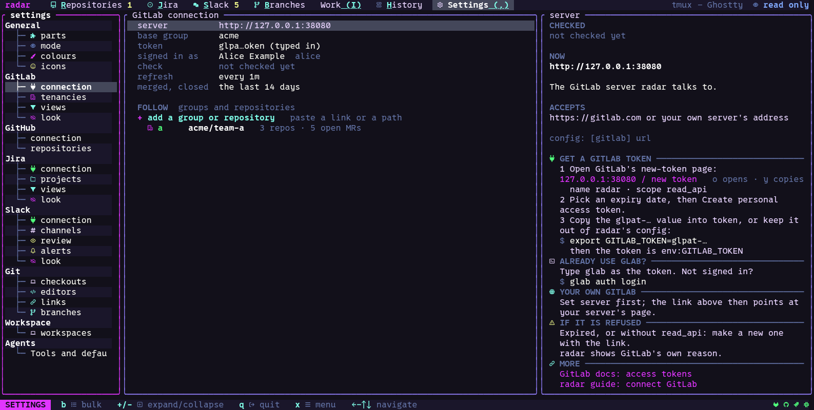
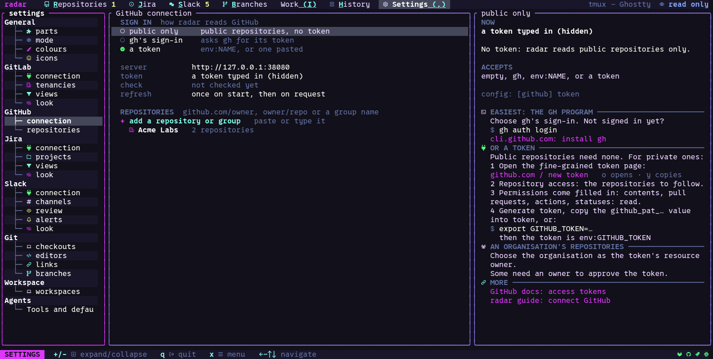
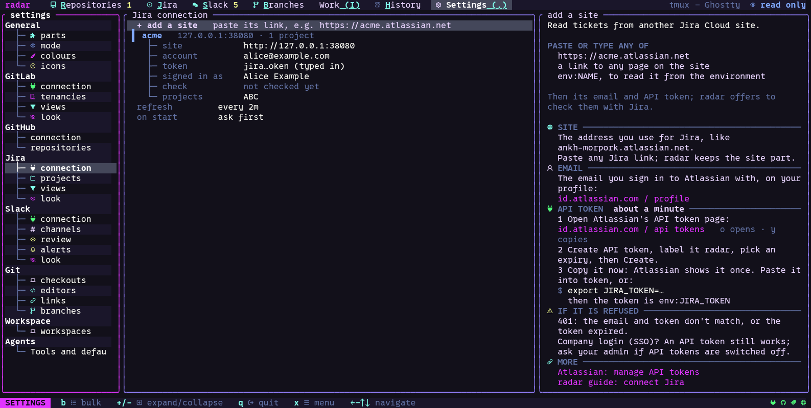
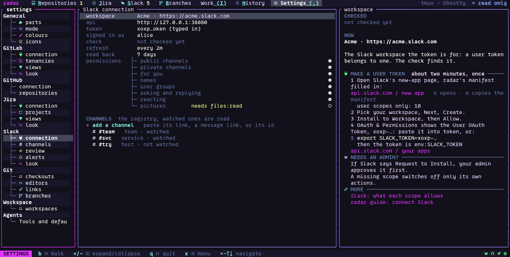

# Connect your services

Back to the [user guide](README.md).

Every service has a **connection** section in Settings (press `,`). They all look alike:

| Row | What it is |
|---|---|
| (found) | a question, if radar found a token in your environment |
| server, site or workspace | where the service is |
| token | `env:NAME` to read an environment variable each time, or the token itself |
| signed in as | who the service says the token belongs to, from the last check |
| check | what the last check said. `⏎` runs it now |
| refresh | how often radar asks the service for changes |

A service may add rows of its own below these, such as GitLab's **access** and the groups
or repositories to follow.

Move to a row and press `⏎` to change it. While you type, the right pane says what the
field accepts and whether what you typed is valid. After you change a connection, radar offers
to check it: it asks the service who you are and tells you whether it works.

**Where tokens are kept.** `env:NAME` stores the variable's name, and radar reads its value
each time it starts. A token you type or paste is saved in the config file (`radar config path`
says where) and shown masked.

**In setup or in Settings.** Setup's step for a service (`radar setup gitlab`, `github`,
`jira`, `slack`) shows this same connection section, so both edit the same fields. Beside it,
setup shows help for the selected row and how to get a token, with links: `o` opens the
token page, `y` copies a command.

## Tokens radar finds

Each service's connection section checks your environment variables. When it finds
something that looks like a token for that service, it asks:

> ? Found in your environment: a Slack user token (SLACK_TOKEN). Use it?

`⏎` uses it (in setup, `space`, because `⏎` moves on). radar then saves the variable's name,
as `env:SLACK_TOKEN`. The question stays until the service is signed in.

| Service | It offers |
|---|---|
| GitLab | `GITLAB_TOKEN`, when the token is set to something else and its value is 20 characters or more (`env:GITLAB_TOKEN` is the default, so it is usually already in use) |
| Jira | a set of variables with a common prefix that has `JIRA` or `ATLASSIAN` in it: a `_BASE_URL` (or `_URL`), an `_EMAIL` (or `_USERNAME`, `_USER`) and a `_TOKEN` (or `_API_TOKEN`) |
| Slack | a variable whose name has `SLACK` and `TOKEN`, and whose value starts with `xoxp-` (a user token) |
| GitHub | nothing in Settings; setup's look for keys notices `GITHUB_TOKEN`, `GH_TOKEN` and `gh`'s sign-in, and its GitHub step offers `gh` |

## GitLab

1. Settings, GitLab, connection: set the **server** (`https://gitlab.com` or your own).
   Optionally set a **base group**, so paths below can be short (for example `acme/platform`).
2. Choose the token's **access**: **read only** needs the `read_api` scope; **read and write**
   needs `api`, which commenting, approving, merging and rebasing use. The new-token link asks
   for the scope that matches.
3. In GitLab, create a personal access token with that scope. Export it, for example
   `export GITLAB_TOKEN=glpat-...`; `env:GITLAB_TOKEN` is the default. You can instead enter
   `glab` (radar uses the login of the `glab` program, and if GitLab turns that token down,
   radar asks `glab` to renew it once) or the token itself.
4. Add the groups or repositories you follow: FOLLOW in setup's GitLab step, or Settings,
   GitLab, **tenancies**. Paste a group's or repository's link, or its path.

If GitLab refuses a write, radar shows GitLab's reason. **merged, closed** in the connection
sets how many days back views with `state:merged` or `state:closed` reach (14 by default).

## GitHub

1. Settings, GitHub, connection (or setup's GitHub step): the API address is
   `https://api.github.com` for github.com, or `https://HOST/api/v3` for a GitHub Enterprise
   Server.
2. Sign in, one of three ways:
   * **public only**: no token; radar reads public repositories.
   * **gh's sign-in**: `gh` as the token. radar asks the `gh` program (`gh auth token`) when it
     needs the token, keeps it in memory for a minute at most, and does not store it.
   * **a token** that can read your private repositories, as `env:NAME` or pasted. The
     new-token link fills in the permissions: contents, pull requests, actions and statuses,
     read. For an organisation's repositories, choose the organisation as the token's
     resource owner; some organisations need an owner to approve the token.
3. Settings, GitHub, **repositories**: enter `github.com/owner` (an owner's repositories),
   `owner/repo` (one repository) or a plain name such as `Client work` (a group of your own).
   With a token set, an owner's group opens a picker of the repositories it can read.

radar follows at most 200 repositories. It reads cached data first and checks for changes
about once a minute while refreshing is active. An open pull request with running checks
is refreshed; previously loaded repository Actions are checked when the repository changes
and at least every 15 minutes during normal syncing. `r` requests a refresh. See the
[GitHub guide](github.md#refresh-loading-and-access-failures) for partial results and errors.

## Jira

radar works with Jira Cloud sites. You need your site, the email of your Atlassian account
and an Atlassian API token (created in your Atlassian account settings).

1. Settings, Jira, connection: give the **site** (`https://acme.atlassian.net`, or any link
   on the site), the **email** and the **token**. Each can be `env:NAME`.
2. Settings, Jira, **projects**: the project keys you follow, under each site. `p` picks from
   the projects you looked at lately on Jira.
3. Settings, Jira, **views**: each view is a saved query (JQL). The Jira screen shows one view
   at a time.

You can add more than one site. Each is one block in the connection section.

## Slack

radar reads Slack as you, so it needs a **user token** (it starts with `xoxp-`). A bot token
does not work. The Slack app the token comes from needs these user scopes, depending on what
you use:

| What | Scopes |
|---|---|
| read the public channels you watch | `channels:history`, `channels:read` |
| read the private channels you watch | `groups:history`, `groups:read` |
| mentions of you, messages to you | `search:read` |
| who wrote what | `users:read` |
| your user groups | `usergroups:read` |
| post review asks and replies | `chat:write` |
| add reactions | `reactions:write` |
| pictures in threads | `files:read` |

After a check, radar says which of these scopes the token lacks. Direct messages and group
messages that mention you come through `search:read`; radar asks for no `im:` or `mpim:`
scope.

The quickest way to an app with these scopes is radar's own app manifest. In setup's Slack
step (or Settings, Slack, connection), `m` copies the manifest and `o` opens Slack's new-app
page with it filled in. It asks for user scopes only. Install the app to your workspace and
copy its user token (`xoxp-…`).

1. Settings, Slack, connection: set the token as `env:NAME` or paste it.
2. Settings, Slack, **channels**: the channels to watch. Paste a channel's link, a link to a
   message in it, or its id.

