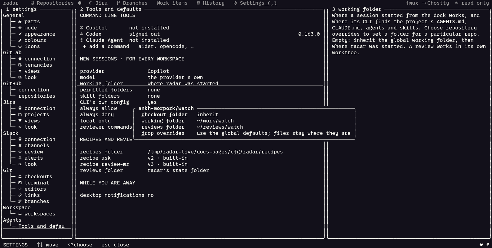

# Settings

Settings controls which work radar follows, how it looks, and where local work is
saved. Press `,`, choose a section in the left pane, then select a row in the
middle. The right pane explains that row, accepted values and its config key.

Press `⏎` to edit or choose a value. `x` shows the actions for the selected row;
`PgUp` and `PgDn` scroll its explanation. Completed changes save automatically.
Invalid values stay in the editor with a reason, so you can correct them. Settings
can be changed in every [mode](README.md#the-mode).


## Change a folder for one repository

For example, keep reviews of `ankh-morpork/watch` in `~/reviews/watch` while
ordinary agent sessions work in `~/work/watch`:

1. Open **Agents / Tools and defaults**. Select **working folder** or
   **reviews folder**, then press `p` for **repository overrides**.
2. Choose **add a repository** and enter `ankh-morpork/watch`. Use a full service
   URL when the same repository path exists on more than one server.
3. Choose **working folder**, enter `~/work/watch`, and confirm with `⏎`.
4. Reopen the repository's overrides and set **reviews folder** to
   `~/reviews/watch`. Set **checkout folder** as well if sessions opened directly
   from that local checkout should match this repository.



This is a local demonstration with fictional folders. Each empty field inherits
its default independently. **Drop overrides** removes the settings and leaves
existing files in place. Changes apply to new sessions and reviews. Reviews run
in their own worktrees; their working checkout and the saved Markdown report are
different locations. See [location precedence and config examples](mcp-and-reviews.md#where-reviews-and-work-are-saved).

## General

### Parts

**Parts** lists the abilities compiled into this radar and whether each is set
up. Select a part to see what it opens and what it adds to other parts. The
terminal information identifies the terminal stack and right-click support.
Use this page when a screen is missing or an integration is not configured;
[connection setup](connect.md) explains the credentials each service needs.

### Mode

Choose **read only**, **write** or **edit** to control remote writes and local
work-item annotations. The mode does not disable local Git actions or Settings.
An environment override such as `RADAR_MODE=read-only` wins for the current run;
a different choice in Settings is saved for the next run.

**Pause if idle** sets the number of minutes without input before background
refreshing stops. Set it to `0` for no idle pause. Input resumes an idle pause;
an explicit pause with `z` lasts until you press `z` again. Enabled automatic
review intake or active background work prevents the idle pause.

### Appearance

Choose the **icon pack**, **theme** and **motion** here, using the same card as
setup's look step. Use `unicode` icons if a Nerd Font is unavailable.

Motion is `subtle`, `full` or `off`. Subtle motion uses fades and brief highlights;
full motion also uses sliding pages and loading effects. Terminal capability and
SSH detection can reduce motion. Input remains available during animations.

### Colours

**Colours** changes individual theme slots, terminal colour depth, the splash,
hyperlinks, images and the mouse pointer. Select a colour slot to choose or enter
a value; resetting it restores the palette's value. Slot overrides remain when
you choose a different palette in **appearance**.

| Config key in `[theme]` | Choices |
|---|---|
| `palette` | a palette from the appearance picker |
| `motion` | `subtle`, `full`, `off` |
| `splash` | `auto`, `off` |
| `hyperlinks`, `images`, `pointer` | `auto`, `on`, `off` |
| `icons` | `auto`, `nerd`, `unicode`, `emoji`, `off`, or a custom pack |
| `colors` | `auto`, `truecolor`, `256`, `16`, `none` |

The `images` preference remains in the configuration, but the current renderer
shows service images as labels and links; it does not enable inline picture
previews. The Kitty splash picture is separate and controlled by `splash`.

### Icons

**Icons** lists the individual glyphs. Select one and press `⏎` to override it;
`r` restores the pack's glyph. These changes are saved in `[icons]`, above the
chosen pack. To create a reusable pack:

```sh
radar icons list
radar icons export nerd > mine.toml
radar icons path
```

The last command shows where custom packs belong. A pack can `extends` another
and supply only the glyphs it changes.

## GitLab

| Section | What to configure |
|---|---|
| **connection** | Server, base group, token, access, refresh interval and the age limit for merged or closed merge requests. The **check** row tests the connection; FOLLOW also lets you add a group or repository. |
| **tenancies** | The groups and repositories to follow, their aliases and display order. Removing one stops following it in radar. |
| **views** | Named filters such as Everything or Needs my action. Add a view, add or remove conditions, or edit the filter as text. Its action menu also renames, reorders or deletes it; the last view cannot be deleted. |
| **look** | Colours for merge-request states, pipelines, tenancies and the repository tree. These affect presentation, not which work is fetched. |

Start with [GitLab connection setup](connect.md#gitlab), then use the
[GitLab pages](gitlab.md) to follow a merge request through its pipeline and review.

## GitHub

| Section | What to configure |
|---|---|
| **connection** | The API server and sign-in method: public repositories, the `gh` login, or a token. Test the connection and add repositories or groups from this section. |
| **repositories** | The repository groups to show. Add an owner, an individual `owner/repo`, or a named group; select repositories, move them between groups or stop tracking them. |

Removing a repository drops radar's held data for it and leaves GitHub unchanged.
The implemented [GitHub pages](github.md) read pull requests, checks and Actions;
an access choice in Settings does not add remote write actions. See
[GitHub connection setup](connect.md#github).

## Jira

| Section | What to configure |
|---|---|
| **connection** | One or more Jira Cloud sites, account emails and tokens. Each site has a check and watched projects. The section also controls refreshing and whether Jira offers to assign and move a ticket when a workspace starts work on it. |
| **projects** | The project keys to follow for each site, the field containing acceptance criteria and the site's colour. The recent-project picker helps select keys already seen on that site. |
| **views** | Named queries built from conditions or written as JQL. New views start with your open tickets. Their menus manage conditions, JQL, names and order; the last view cannot be deleted. |
| **look** | Colours for statuses, issue types, ages, ticket fields and tree rows. |

Configure a site using [Connect Jira](connect.md#jira), then follow
[the ticket workflow](jira.md). A valid connection can still show an empty view
when its JQL matches no tickets.

## Slack

| Section | What to configure |
|---|---|
| **connection** | A user token, connection check, refresh interval and how far back to read. Permission rows explain the scopes needed for each capability. The channel registry can also be edited here. |
| **channels** | Channel aliases, purpose, kind, colour and whether each channel is watched. A channel may stay registered without being watched. |
| **review** | The channel, user group, message template and link text used for review asks, with a live example. A separate test channel sends no group mentions. **Reask** controls when an unanswered ask is due again, using working days/hours, a next-working-day time or `never`. **Posting** is `at once` (the default: the ask is sent the moment it is chosen from a merge request's menu) or `draft first` (the draft page shows it, and `p` posts after a confirmation). |
| **alerts** | Name prefixes and/or `key=value` labels mapped to repositories, services and default environments. Rules are tried from the top; if both prefix and label are set, both must match. Unmapped alerts can be assigned here. **Keep resolved** controls retention of resolved alerts and failed jobs; firing alerts stay while they fire. |
| **look** | Compact or cozy message density, message and tree colours, and colours for alert states. |

[Connect Slack](connect.md#slack) explains the token and scopes. The
[Slack guide](slack.md) covers channel and thread pages, replies and review asks.
Automatic local review intake is enabled by the `auto_review` config setting;
follow [Start reviews from Slack](mcp-and-reviews.md#start-reviews-from-slack) for
the complete setup.

## Git

| Section | What to configure |
|---|---|
| **checkouts** | Root folders to scan for local clones and how many folders deep to look. The last scan time shows whether the index is current. |
| **terminal** | The terminal command to use outside tmux, or automatic detection. Inside tmux, opening a terminal uses a new tmux window. |
| **editors** | Project types identified by marker files, and their editor commands. A checkout's top-level files determine which type matches. |
| **links** | Explicit mappings from service repository paths to local clones. Select a link and press `o` to set its worktree-folder template. |
| **branches** | Your branch-name identity, branch and worktree templates, an optional command to run in a new worktree, ticket-type names and repository-path branch conventions. The longest matching convention wins; a link's own branch template takes precedence. |

For example, add `~/work` in **checkouts**, refresh [Branches](git.md), and select
the clone radar found. Add a **link** when a service repository is not matched
to that clone automatically. The global worktree template is in **branches**;
a link's template overrides it for that clone. Folder examples and inheritance
are in [Where reviews and work are saved](mcp-and-reviews.md#where-reviews-and-work-are-saved).

## Workspace

**Workspaces** registers folders containing related clones. Add a folder, or
accept a discovered workspace when offered. These folders appear under
**Repositories / Local workspaces**. Workspace branches, worktrees and ticket
notes are described in [Workspaces](workspaces.md).

## Agents

**Tools and defaults** contains installed-provider status and sign-in actions,
additional terminal commands, defaults for new sessions, permission rules,
recipes, review output and desktop notifications. Select a row to see its
specific actions; `p` on a provider opens its paths and folders, while `p` on a
working or review folder opens repository overrides.

Use [Agents](agents.md) for provider setup, session defaults and approvals, and
[MCP and local reviews](mcp-and-reviews.md) for connected context and review
storage. Provider, model and folder changes apply to new sessions; an existing
session keeps its current setup.

## The config file

```sh
radar config path
radar config show
```

The file is `~/.config/radar/config.toml`, or
`$XDG_CONFIG_HOME/radar/config.toml`, including on macOS. Radar reads it at
startup and saves completed Settings changes to it. Restart radar after editing
it by hand. `config show` prints the configuration; treat it as sensitive if you
store tokens directly in the file.

```toml
[gitlab]
url = "https://gitlab.com"
token = "env:GITLAB_TOKEN"

[general]
mode = "read-only"
idle_minutes = 30

[theme]
palette = "silkcircuit-neon"
motion = "subtle"
```

For the local files created by these settings, see
[What radar stores and sends](privacy.md). To find a screen after configuring it,
use [Find a page](pages.md).
