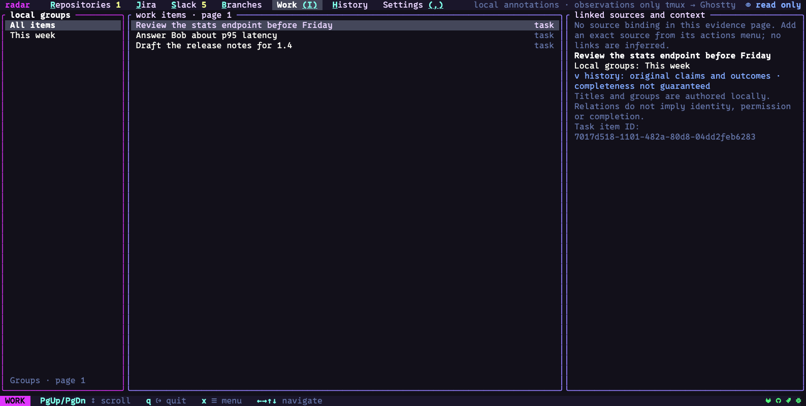

# Work: local tasks, groups and linked sources

Work keeps your own task titles and groups beside exact source items from radar's other
screens. It helps you return to the ticket, change and checkout for one piece of work
without changing their service identities. The information is saved locally in radar's
activity storage; adding a task or group does not create a Jira ticket or provider label.

Press `I` to open Work. The left pane lists local groups, the middle lists items, and
the right shows the selected item's linked sources and recorded context.

This is a [fictional example capture](images/INDEX.md). Its tasks were prepared in the
demo's local store; they are not tasks supplied by a remote service.

## Connect one piece of work

Continue the fictional `WATCH-12` example from [local workspaces](workspaces.md): you
want one task called **Review the patrol route** that leads back to its ticket and change.

1. Select `WATCH-12` on its service screen, press `x`, and choose **add to work item…**.
2. In **Add to a local work item**, choose an existing task or **Create a new task…**.
   Enter `Review the patrol route` if you are creating it. The chooser can page through
   existing tasks with its **More existing items…** and **Previous items…** rows.
3. In **Choose sources to link**, toggle the exact sources you want. The selected item
   starts included; related candidates are choices, not automatic links. Each row shows
   its kind, service, service instance and ID. Choose up to four sources in one operation.
4. Select **Review local links…**. Read the task and each proposed reference, then
   confirm **save locally** with `y`, or cancel with `n`.
5. Press `I` and select the task. Its right pane now contains those source references.
   Move into that pane, select a source, and press `o` or `⏎` to open it in its owning
   radar screen. `c` copies the exact scoped locator if you need to identify it elsewhere.

Repeat **add to work item…** from another supported source and choose the same task
when you want to attach a further change or checkout. The action is offered for tickets,
repositories, changes, local checkouts, pipelines, jobs and workflow runs; Slack messages
do not currently offer it directly. Equal titles do not merge separate tasks,
and linking sources does not make them the same item. Radar checks source identities
again before saving; a changed, unavailable or ambiguous source must be selected and
reviewed again.

Creating tasks, assigning groups and saving source links are local additions and require
**write** or **edit** mode. In **read only**, you can browse and review the question, but
confirmation does not save. Change the mode in **Settings → General → mode** when you
want to save; see [the mode](README.md#the-mode).

## Create and organize tasks

You can start a task without a source: press `n` in Work, type its short title, and confirm
**Save these local work annotations?**. It appears with no linked source until you add
one from another screen's actions menu.

Select the task and press `t` for **set local group label…**. Choose an existing group or
**Create a local group label…**, enter a name such as **This week**, and review the save
question. Assigning a group adds that label; it does not replace the task's other groups.
Groups belong to radar and do not edit the linked services' labels.

Choose **This week** in the left pane to see its items, or **All items** to clear the group
filter. Groups without any items can still appear. Two groups with the same name retain
separate identities; the list shows an ID suffix to distinguish them. A group marked
ambiguous cannot be applied until its conflicting evidence is resolved.

### Pages, filters and focus

| Control | Result |
|---|---|
| `tab` / `shift-tab` | Move between groups, items and source/context detail |
| `⏎` on an item | Focus its right-hand detail |
| `/` | Filter the current loaded item page by text; submit an empty filter to clear it |
| `[` / `]` in the groups pane | Previous / next group catalog page, when available |
| `[` / `]` elsewhere | Previous / next item page, when available |
| `r` | Refresh local work from a new snapshot, or review a retained pending change |
| `x` | Show actions for the focused pane and selected item |

The text filter applies only to the current item page. A blank result does not mean
there are no matching items on other pages. Group paging and item paging are separate;
the pane footers show which page you are on. While a read or source check is in progress,
wait for it to finish before starting another operation.

## Inspect sources and original evidence

The right pane names each exact linked source and how its association was recorded.
Select a source with `↑` and `↓`. Its context shows the task, local groups and recorded
claims. When the owning service part is unavailable, opening is unavailable too; `c`
still copies the source locator so you can recover the exact reference.

Press `v` to open **Read original evidence**:

| Choice | What it displays |
|---|---|
| Task evidence | Recorded claims and original outcomes for the selected item |
| Linked source evidence | Evidence for the available one-hop linked sources |
| Next evidence page | More records in the same captured snapshot, when available |

Evidence appears in the right pane. Scroll it with `PgUp`/`PgDn`; `esc` returns to linked
sources. Records identify authored relations and labels, original action outcomes, and
recording/session information. A partial-evidence notice means more records remain or
the bounded expansion omitted some; a recording-gap notice means coverage is incomplete.
Use **Next evidence page** where offered, and [History](history.md) for the original
action's broader sequence.

A title, group or reference is something you recorded about work. It does not mark the
task complete, authorize an agent to act, or establish that a change was deployed.

## Recover a pending change

If saving is interrupted or radar cannot establish whether the save committed, it retains
the original change and its IDs. Work displays the pending question or recovery notice.
Press `r` to inspect/review that retained change. Outside the confirmation dialog, `y`
copies its JSON batch for inspection with the [`radar work` command](README.md#6-the-command-line).
Inside the dialog, `y` is the save confirmation.

Retry uses the retained identities. Cancelling that review closes the question; it does
not reverse an earlier attempt that may already have committed. If source identity has
changed or recovery is ambiguous, saving remains blocked and the notice explains what
must be checked. New-task actions can be unavailable while that change needs recovery.

| What you see | Next step |
|---|---|
| No local work items | Press `n`, or use **add to work item…** from a source |
| No items match this page filter | Clear/change `/`, choose another group, or page through items |
| No source binding in this evidence page | Add an exact source from its actions menu, or inspect more available evidence |
| Groups unavailable | Close the chooser and press `r` to reload the group catalog |
| Local activity storage unavailable | Check access to radar's [state directory](privacy.md#files), restart, then refresh |
| Source changed or became unavailable | Restore its connection and select/review it again; follow any retained-change recovery notice |

Next, use [History](history.md) to follow what radar actually recorded for a task's source
or a particular operation.
